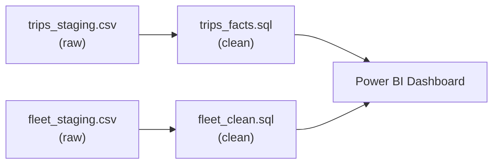

# Haraka_rides project
Haraka rides project is derived from data from a ride-hailing company whose systems export raw data. The raw data is cleaned and modelled in PostgreSQL, exposed through a layer of analysis views, and visualized in an interactive Power BI dashboard.
Built as a self-directed project to practise the full workflow a data analyst runs — staging, cleaning, modelling, a views layer for hand-off, and a business-facing dashboard.

Whats in here
|File            | what it represents                                                                                             |
|----------------|----------------------------------------------------------------------------------------------------------------|
|`fleet_clean.sql` | Staging → production load:cleans, de-duplicates and type-casts the raw fleet tables i.e dim_vehicles, maintenance_logs, fuel_logs      |
|`trips_facts.sql` |stanging -> production stage facts table, fitted with clean columns                                                                                                                |
|                |                                                                                                                |
|                |                                                                                                                |

### The data
---
`trips_staging.csv` - 406 rows, 18 columns
One row per trip, but denormalized - customer, driver, and vehicle details are repeated on every row they appear on, exactly as a booking-app export would look before anyone modeled it properly.

`fleet_staging.csv` - 106 rows, 17 columns
One row per fuel fill-up OR maintenance event - event_type tells you which. Vehicle details (plate, make, model, year, type, status) repeat on every row for that vehicle. Fuel-only columns are blank on maintenance rows, and vice versa.

> Note: the original system exports were lost; these two staging CSVs are schema-faithful sample data regenerated by `scripts/generate_sample_data.py` (deterministic). The SQL pipeline and dashboard remain the real deliverables.

### Data Pipeline Flow

Here is the end-to-end data pipeline from raw data to the dashboard.

---

 The DashBoard
---

 ### How to run it
------

- [x] Load the raw data into a trips_staging and fleet_staging schemas and create respective tables (all text columns).
- [x] Run trips_facts.sql  to build and populate fact_trips table which is clean.
- [x] Run fleet_clean.sql to create build the fleet schema and its dimensional tables
- [x] Connect Power BI (Get Data → PostgreSQL) as load Haraka_rides.pbix, apply the theme, and build the report.

### Tools
---
PostgreSQL · DBeaver · Power BI Desktop · SQL (CTEs, window functions, views)

### Author
----
  Erickson
